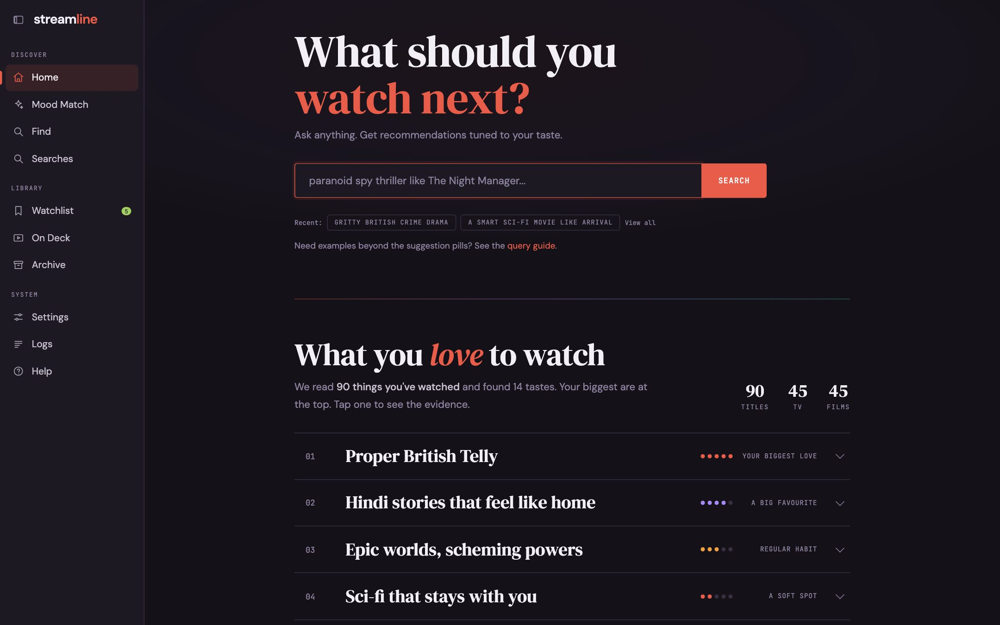
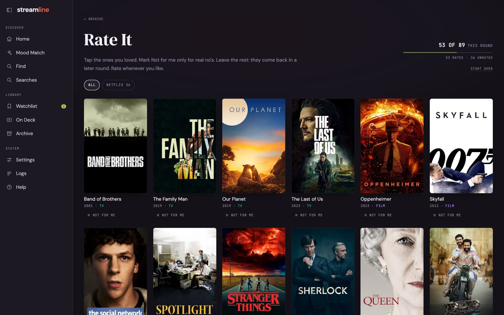

Streamline is used from the browser, setup included.
The terminal is only needed to install it and copy your exports onto the machine; every step after that also works from the terminal if you prefer.

Prefer Docker? Follow [Docker](/guides/docker/) instead of steps 1 to 4, then continue from step 5.

## 1. Install

You need Python 3.10 or newer, a free [TMDB API key](https://www.themoviedb.org/settings/api), and a key for one LLM provider (Anthropic, Google Gemini, or OpenAI). A local OpenAI-compatible server such as Ollama also works, with no key.

```bash
git clone https://github.com/abhichandra21/streamline.git
cd streamline
python3 -m venv .venv && source .venv/bin/activate
pip install -r requirements.txt
```

## 2. Copy in your watch history

Download your history export from each service you use; [Watch history](/guides/watch-history/) says where to find each one.
Copy the files into the `data/` folder, for example `data/netflix/export.zip`.

## 3. Start the web UI

```bash
./recommend-web start
```

Open [http://localhost:5051](http://localhost:5051).
Until your library is built, every page takes you to **Get started** at the top of Settings.

## 4. Get started in Settings

1. Under **Keys**, paste your TMDB key and the key for your AI provider. (Keys in a `.env` file in the same folder work too.)
2. Under **Watch history**, point each service at its export file, and leave the ones you don't use empty.
3. Press **Check exports**. It reads the files and counts your watches, with no TMDB or AI calls.
4. Press **Build my library**. It matches every title on TMDB, writes a short description of each with the fast model, and builds a first taste profile. That is one AI call per title, so a large history takes a while and costs a little. The page shows how it is going.

Descriptions are cached, so later rebuilds only pay for new titles.
From the terminal, `./recommend setup` does the same build.



The sidebar has everything:

| Page | What it is for |
|---|---|
| **Home** | Ask for something in plain English, and see your taste rows. [Search](/guides/search/) |
| **Mood Match** | Answer a few questions about tonight instead of typing. [Mood Match](/guides/mood-match/) |
| **Find** | The best-rated titles you haven't seen, by filters, with no LLM. [Find](/guides/find/) |
| **Searches** | Your past searches and their results. [Watchlist and Searches](/guides/watchlist-and-searches/) |
| **Watchlist** | Titles you saved for later. |
| **On Deck** | Shows you follow, and which have new episodes. [On Deck](/guides/on-deck/) |
| **Archive** | Everything you've watched, plus Seen It and Rate It. [Archive](/guides/archive/) |
| **Settings** | Provider, models, filters, and region. [Settings](/guides/settings/) |

## 5. Tell it what you loved

The taste profile is built from the titles you mark **Loved**, not from everything you've watched.
Open **Archive**, then **Rate It**, and tap through your history.



Your ratings count in searches straight away.
To update the taste rows on the home page, press **Rebuild taste profile** under Rebuild in Settings, or run `./recommend setup --refresh-profile`.
The app reminds you when the profile is out of date.

## 6. Make it yours

- Exports miss things watched long ago or elsewhere. **Archive > Seen It** lets you tap through famous titles you've already seen.
- In **Settings**, set your region and the streaming services you pay for, so results show where to watch.
- **Follow** shows you are keeping up with, and On Deck tells you when new episodes are out.
- Connect [Plex](/guides/plex/) to record plays as they happen.

## What it costs

TMDB and IMDb data are free. The only cost is the LLM, and with the default Claude models it is small:

| What | Cost |
|---|---|
| Describing your history, once | About $1 per 1,000 titles |
| Building the taste rows the first time | About $1.70 for a real library of a couple of thousand titles |
| Writing the taste profile, at setup and on every `--refresh-profile` | One reasoning-model call per 200 titles plus one to combine them: $0.08 for a 90-title library, and an estimated $2 to $3 for a couple of thousand titles |
| Rebuilding the taste rows with the same ratings | Nothing; the answers are saved |
| A search or Mood Match run | Usually about $0.06, rarely more than $0.15 |
| Find, On Deck, Archive, Watchlist, the API | Nothing; no LLM calls |

Each terminal search prints its exact token use and cost.
Routine `--refresh-data` runs only pay for descriptions of new titles; they never rebuild the profile.
A local model through Ollama costs nothing at all.

Everything also works from the terminal; see [Command line](/reference/cli/).
