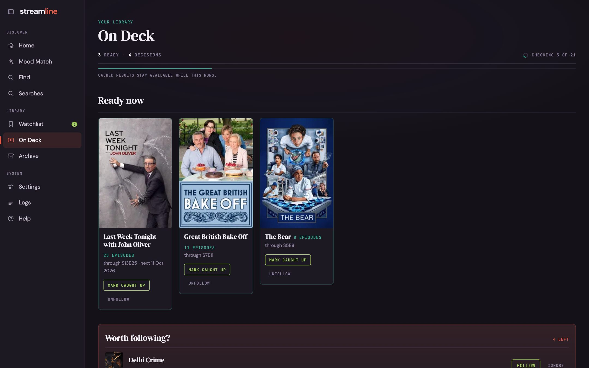

**On Deck** keeps track of the shows you follow.

- **Ready now**: followed shows with episodes you haven't watched. **Mark caught up** when you've seen them.
- **Worth following?**: shows from your history with a new season. **Follow** or **Ignore**.
- **Coming soon**: followed shows with an announced next episode or season, grouped by date.

Follow a show from **Worth following?** or from the show's title page.

Each show also says where it streams in your region, such as Apple TV+, and so does its title page.
A show with no known streaming service shows nothing there.
Streaming data comes from [JustWatch](https://www.justwatch.com) through TMDB.

## When an episode counts as aired

TMDB gives an episode's air date but not its time.
Streamline looks up each followed show's release time on [TheTVDB](https://thetvdb.com) and counts the episode as aired at that time.
This covers streaming shows too.
Netflix releases everything at 3 AM Eastern worldwide, so Netflix shows count from 2 AM Central.
Apple TV lists its shows at midnight but releases them at 9 PM Eastern the evening before, so those count from 8 PM Central the night before.
TheTVDB gives no timezone, so the time is read in the show's home country: US shows in Eastern time, UK shows in London time, Indian shows in India time, even when a US streamer carries them.
This needs a TheTVDB API key in `TVDB_API_KEY`.
Without one, or for a show TheTVDB has no time for, the episode counts from midnight, US Central time.

On Deck checks TMDB in the background when you open it.
Cached results stay on screen while it runs.
