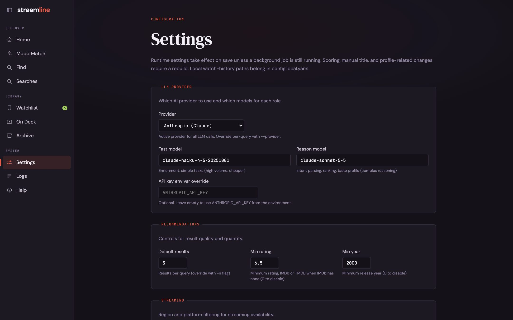

## Settings

The **Settings** page changes settings from the browser: API keys, provider and models, result count, minimum rating and year, region and platforms, Mood Match question counts, timeouts, scoring, and where your watch-history exports are.
It saves only what you change, into `config.local.yaml`. `config.yaml` keeps the shipped defaults, so updating Streamline with `git pull` never conflicts with your settings.

:::note[Saved settings before 2.0.1?]
Older versions saved settings into `config.yaml`, which can make `git pull` stop with "your local changes would be overwritten".
Run `git diff config.yaml` to see what you changed, copy those values into `config.local.yaml`, then run `git checkout config.yaml` and pull again.
:::

Most settings take effect when you save.
Scoring and profile-related changes need a profile rebuild, and the app tells you when one is due.

### Keys

The Keys section sets TMDB, TheTVDB, the AI provider keys, and Plex.
It shows whether each key is set, whether it came from the page or from the environment (`.env`), and its last four characters. The full key is never shown again.
A key saved here goes into `data/keys.env` on the server and wins over `.env`. It works from the next page you open, with no restart.
Remove the saved value to go back to the one in `.env`.

### Watch-history exports

Each provider's export path is relative to the Streamline folder on the server, one per line. Leave it empty to turn that provider off.
Changes take effect at the next `./recommend setup --refresh-data`.
A provider with saved watch events can't be turned off here, because the next rebuild would delete those events.

## Logs and status

- **Logs** shows the app log in the browser.
- `/status` returns JSON with the provider, models, cache counts, when the profile was built, when IMDb ratings were refreshed, and any running background jobs.
- `/healthz` returns `ok`, `busy`, or `not ready`, for monitoring.

## Password

Set `STREAMLINE_PASSWORD` to put the whole web UI behind a browser password prompt.
`/healthz` and the Plex webhook stay open; see [Running as a service](/guides/running-as-a-service/).
